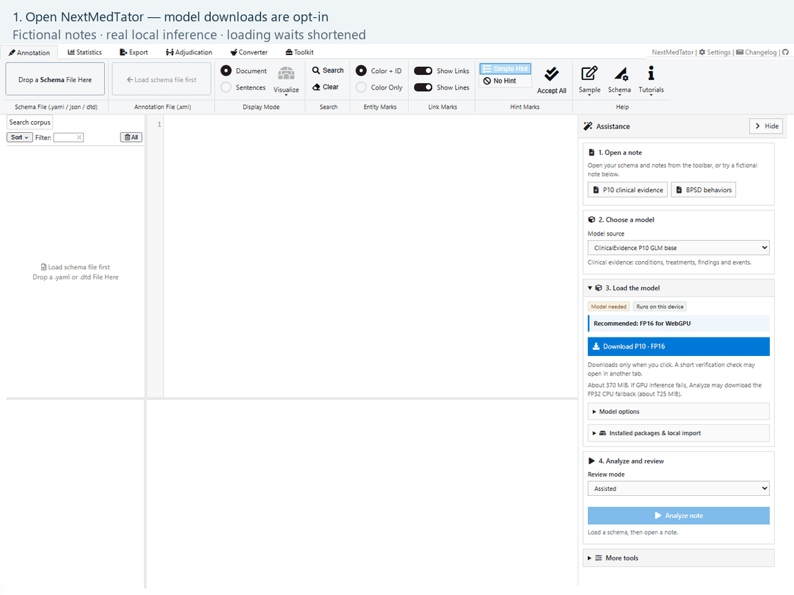

# NextMedTator

**Annotate clinical text, run local models, and review every suggestion in your browser.**

[Open the app](https://nmt.sidata.plus) · [Step-by-step tutorials](tutorial/README.md) · [Download a compiled release](https://github.com/sidataplus/NextMedTator/releases) · [Report an issue](https://github.com/sidataplus/NextMedTator/issues)



*Recorded in Chrome with real P10 and BPSD WASM inference on fictional notes. The walkthrough shortens loading waits; it is not a speed benchmark.*

## What you can do

- **Annotate by hand:** load a schema and notes, mark spans, edit attributes, and save XML.
- **Ask for local assistance:** use ClinicalEvidence P10 or BPSD, inspect suggestions, and add only the annotations you choose.
- **Choose a review mode:** Assisted for individual decisions, Auto apply for unreviewed machine tags, or Blind for freezing independent annotations before revealing predictions.
- **Work across a corpus:** select notes for batch analysis with a low-CPU default, progress and estimated remaining time; search text locally and inspect annotation statistics.
- **Keep the evidence:** export portable projects containing source text, annotations, model runs and review history. Browser recovery is separately opt-in.

The application is a static site. Inference runs on your device; notes are not sent to a model server. Model weights download **only on request**, never on website load or precision selection. After selecting FP16, an explicit Analyze request may download the disclosed FP32 WASM fallback if needed. Installed packages are reused locally.

## Try it in five steps

1. Open [nmt.sidata.plus](https://nmt.sidata.plus) in desktop Chrome or Edge.
2. In **Assistance → Try a fictional note**, choose **P10 clinical evidence** or **BPSD behaviors**. This loads a synthetic note, its matching schema and the model selection. It starts no download.
3. Expand **Get a model package**, click **Show approved public model**, choose **Model precision to download**, and click the corresponding **Download and install** button. Alternatively, import a local `.nmt-model.zip` package.
4. Keep **Mode → Assisted** and click **Analyze note**. Open **Add to annotation**, check the fields, then click **Write annotation**.
5. Click **Export evidence project** to keep a portable `.nmt.zip` backup. Use **Open evidence project → Open project/files** to reopen it.

No model is required for manual annotation. Use the ribbon's **Sample** button for a small manual task, or load your own schema and text files.

## Model packages

| Model | Purpose | Download | Qualified browser execution |
|---|---|---|---|
| [ClinicalEvidence P10 GLM base](https://huggingface.co/na399/clinical-evidence-gliner2.5-base-lora-p10-glm) | Clinical evidence spans and attributes | About 721 MiB | WebGPU with WASM fallback, fp32 |
| [BPSD GLiNER2.5 base](https://huggingface.co/na399/bpsd-gliner2.5-base-lora-20261012) | Behavioral and psychological symptom spans and attributes | About 725 MiB | WebGPU with WASM fallback, fp32 |

Both models also offer **FP16 WebGPU** packages (about **369 / 372 MiB**, P10 / BPSD). These preserve all spans and attribute choices on eight synthetic regression notes, with small confidence differences. FP16 saves download bytes; it did not improve warm inference speed on this machine. **INT8 weights with FP32 WASM computation** are a separate experimental option: smaller downloads, changed outputs, and individual suggestion review required. See [precision benchmarks and choices](docs/nextmedtator/PRECISION.md).

Allow at least twice the download size in browser storage, plus runtime memory. Downloads show bytes, progress and an estimated remaining time when enough transfer data is available. Batch analysis estimates remaining time after the first completed note; initialization has no ETA.

For bulk assistance, open **Batch analysis**, use **Select all** or check individual notes, then click **Analyze selected**. The default **Low CPU** setting caps WASM at one thread, including automatic fallback; **Balanced** permits up to four. Both process one note at a time using one model session. Requests are prepared on demand, raw outputs are released after saving each result, and the selector shows 50 notes per page. These reduce temporary work and memory overhead; loaded notes, retained review history and model sessions still use RAM. **Pause** stops the current batch and retains completed results; it does not create a resumable background job.

These packages retain their pinned training schemas and model-specific limits. Oversized notes are rejected rather than silently truncated. Automatic GPU execution falls back to **original FP32 WASM**, never experimental INT8; **Assistance → Model packages → Inference device** also lets you choose CPU explicitly. FP16's FP32 fallback is a separate, cached download of about 725 MiB; install the matching FP32 package beforehand for offline fallback. See the [original FP32 comparison](docs/nextmedtator/WEBGPU.md), [precision results](docs/nextmedtator/PRECISION.md), and [model contracts](docs/nextmedtator/CURRENT-MODELS.md).

Model files have their own license terms, included in each package. Public availability does not change those terms. Synthetic parity checks establish technical consistency, not clinical accuracy.

## Tutorials in this repository

| Guide | Outcome |
|---|---|
| [1. Your first annotation](tutorial/01-quickstart.md) | Open a fictional task or load your own files; find the main controls |
| [2. Local model assistance](tutorial/02-local-models.md) | Explicitly load a model, run P10 or BPSD, and choose a review mode |
| [3. Review, export and recover](tutorial/03-review-export.md) | Review fields, reopen a portable project, search and save a recovery copy |

Every guide includes screenshots captured from the application. [Example notes and schemas](tutorial/examples) are included alongside the tutorials. All example notes are fictional.

## Run a compiled release locally

Download the latest `NextMedTator-*-static.zip` from [Releases](https://github.com/sidataplus/NextMedTator/releases). Serve the extracted files over HTTP on localhost or HTTPS; opening `index.html` as a `file://` URL is unsupported. To use this repository's server with the included WASM isolation headers, extract the archive's contents into `dist/` in a repository checkout, then run:

```sh
uv run --locked python scripts/serve_static.py --directory dist --port 4173
```

Open `http://127.0.0.1:4173`. The static archive includes the compiled Rust WASM core and browser runtimes; model weights remain separate. Local package import works on localhost. Public R2 downloads are configured for the deployed app origins; use a local package when running the app locally.

## Build from source

Requirements: Node.js 22.16+, pnpm 10.18.3, uv, and Rust 1.90.0 with the `wasm32-unknown-unknown` target. Use the committed lockfiles.

```sh
pnpm install --frozen-lockfile
uv sync --locked
rustup toolchain install 1.90.0 --profile minimal --target wasm32-unknown-unknown
pnpm build:production
pnpm audit:assets
pnpm preview:legacy
```

The production build writes `dist/` and selects the two public R2 model packages. Python is used at build time; the deployed site needs no Python service. Cloudflare Pages hosts [nmt.sidata.plus](https://nmt.sidata.plus), with weights on a separate public R2 domain. Preserve the generated `_headers` when deploying. See [deployment details](docs/nextmedtator/DISTRIBUTION.md) and [build instructions](docs/nextmedtator/BUILD.md).

## Validation and development

```sh
pnpm test
uv run --locked python tests/browser/test_legacy.py
uv run --locked python tests/browser/test_assist_panel_layout.py
uv run --locked python tests/browser/test_legacy_recovery.py
uv run --locked python tests/browser/test_corpus_search.py
```

[Recording instructions](tutorial/README.md#reproduce-the-screenshots-and-gif) describe the real-model tutorial check. [Model packaging](docs/nextmedtator/MODEL-PACKAGES.md), [browser contracts](docs/nextmedtator/ENTITY-CONTRACT-BROWSER.md), and [security and storage](docs/nextmedtator/SECURITY.md) cover the technical details.

Application code is distributed under [Apache-2.0](LICENSE). Dependencies and model artifacts retain their respective licenses and notices.
