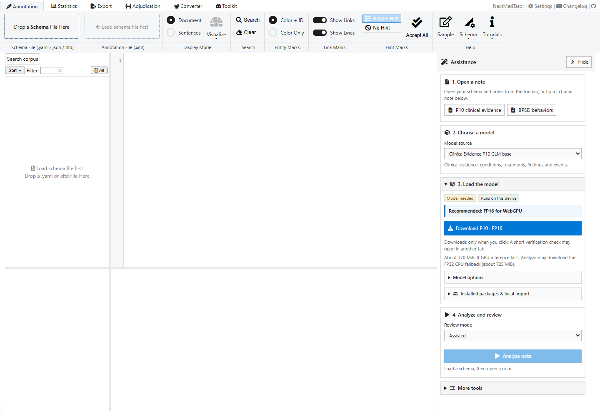
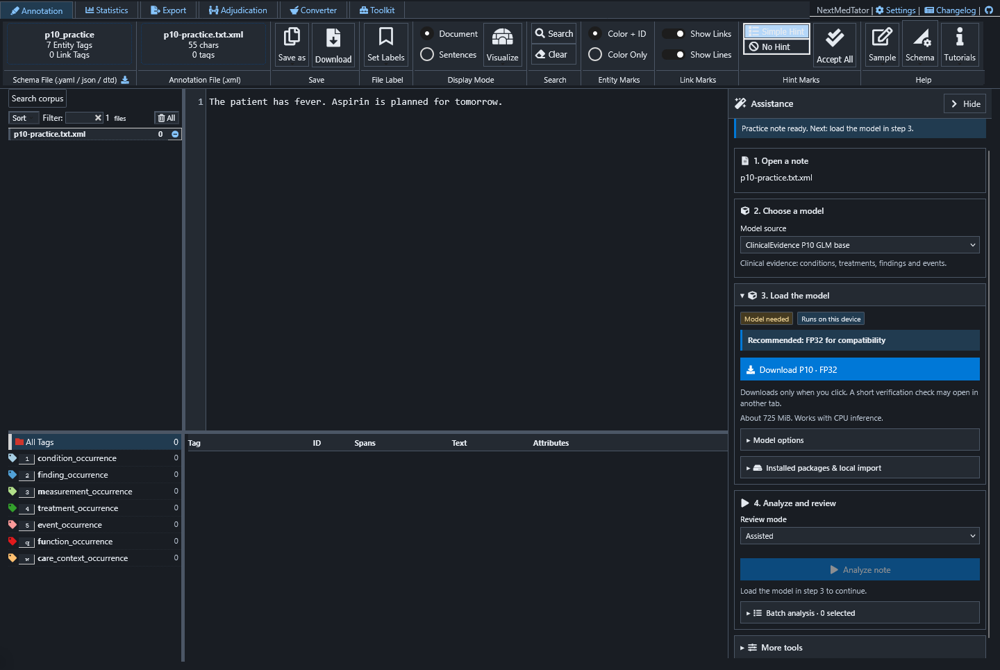
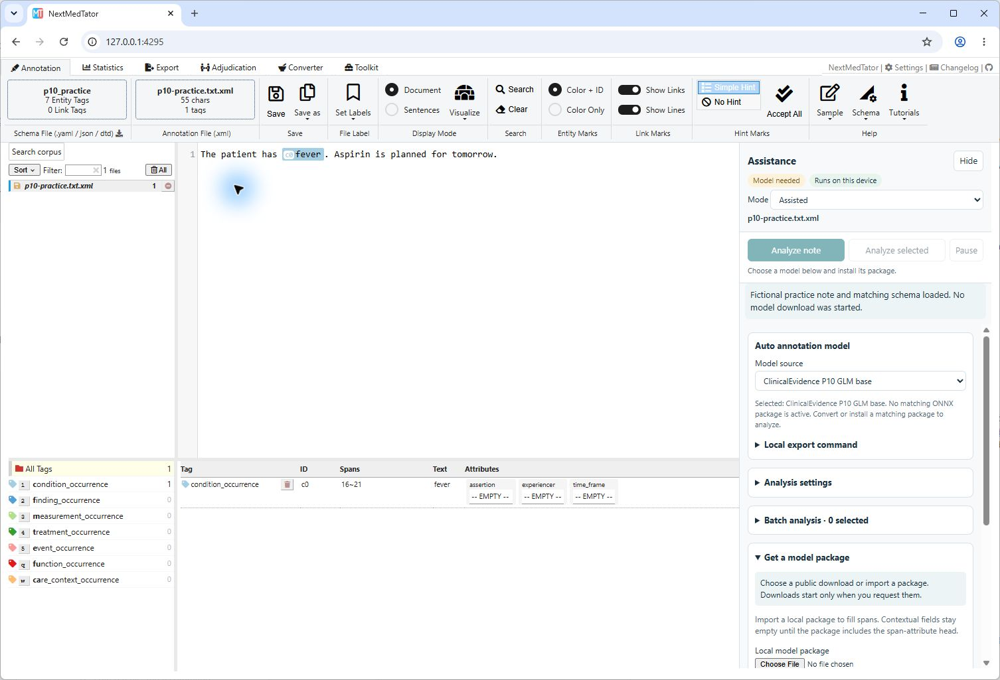

# 1. Your first annotation

**Goal:** load a fictional note and its schema without downloading a model.

## Step 1 — Open the app

Open [NextMedTator](https://nmt.sidata.plus) in a current desktop browser. The
ribbon stays at the top, files are on the left, note text is in the center,
and Assistance is on the right. The annotation table appears below the note.

**Appearance:** open **Settings → Appearance** to choose System, Light or Dark.
System is the default and follows changes on your device. Explicit choices persist
in this browser.

Manual annotation needs no model. **Analyze note** remains disabled until both
a note and a compatible loaded model are available.

## Step 2 — Load a practice task

In **Assistance → 1. Open a note**, choose **P10 clinical evidence**.
The button loads the note, seven-family DTD, model selection and Assisted mode.
It does not download weights. If notes are already open, the app asks before
replacing them; cancel to keep working or export them first.

The note is: “The patient has fever. Aspirin is planned for tomorrow.”
The initial annotation count is zero. **BPSD behaviors** loads a different
fictional note and the BPSD schema.

## Step 3 — Bring your own files

Click **Drop a Schema File Here** in the ribbon and choose a `.dtd`, `.yaml` or
`.json` schema. Then use the neighboring annotation drop zone to open `.txt`
or annotation `.xml` files. Drop files into those zones if preferred.

You can practice with [p10.dtd](examples/p10.dtd) and [p10.txt](examples/p10.txt).
Load the schema first. For model assistance, entity and attribute names must
match the selected model's contract; unrelated schema defaults are not model
predictions.

## Step 4 — Choose how to annotate

For manual work, select text in the note, right-click the selection, and choose
the entity type from the annotation menu. For example, select **fever** and
choose **condition_occurrence**. Inspect the resulting row below the note and
edit its attributes there. The ribbon's **Sample** button loads a small task
for practicing this workflow without any model.

This desktop Chrome capture shows the new span and empty attributes, ready for
human entry. The **Model needed** badge confirms that no model was loaded.

For assistance, continue to [Local model assistance](02-local-models.md).
Use **Hide** to collapse Assistance when you want more room for the text.
Use **Save as → Download a copy** to save the current annotation as XML.

[Tutorial index](README.md) · [Next: local model assistance](02-local-models.md)
