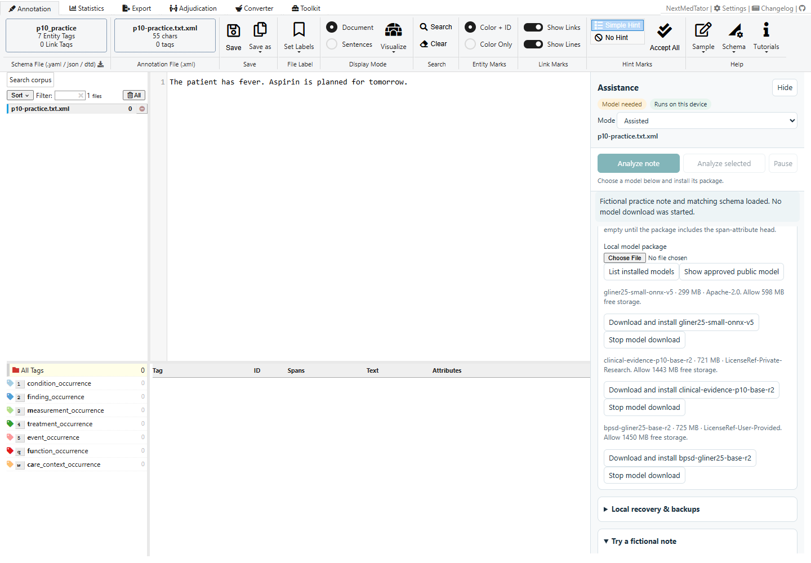
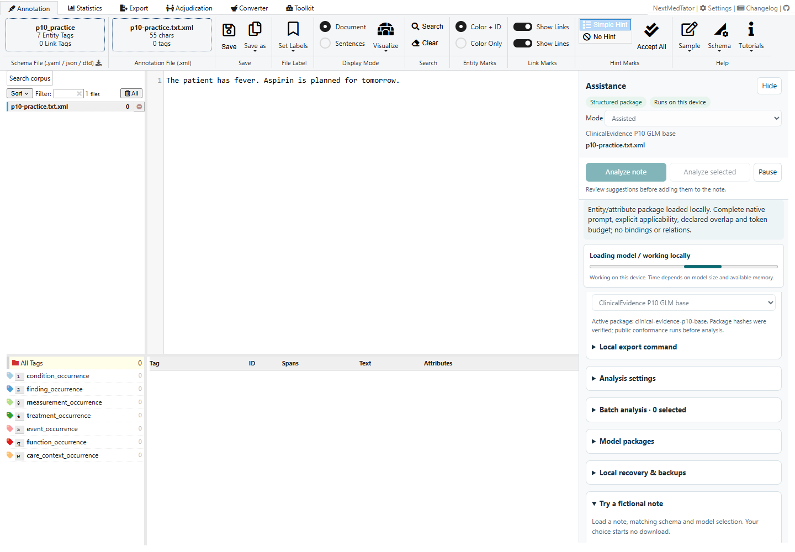
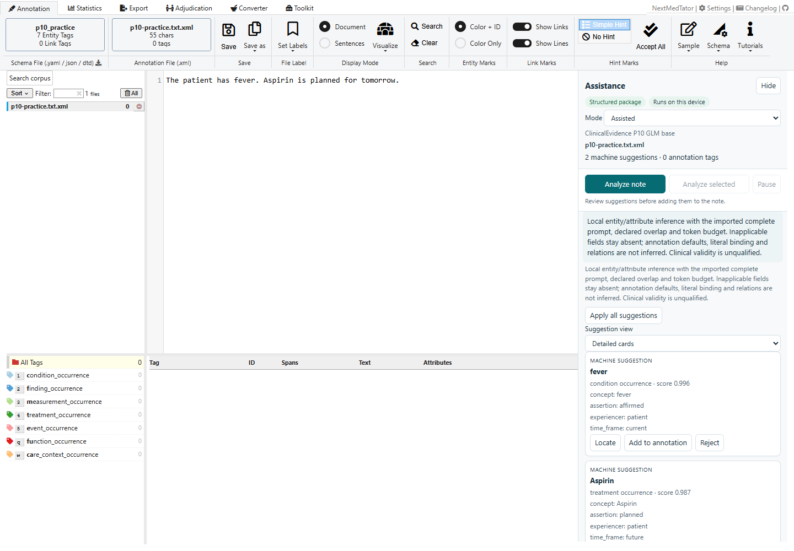
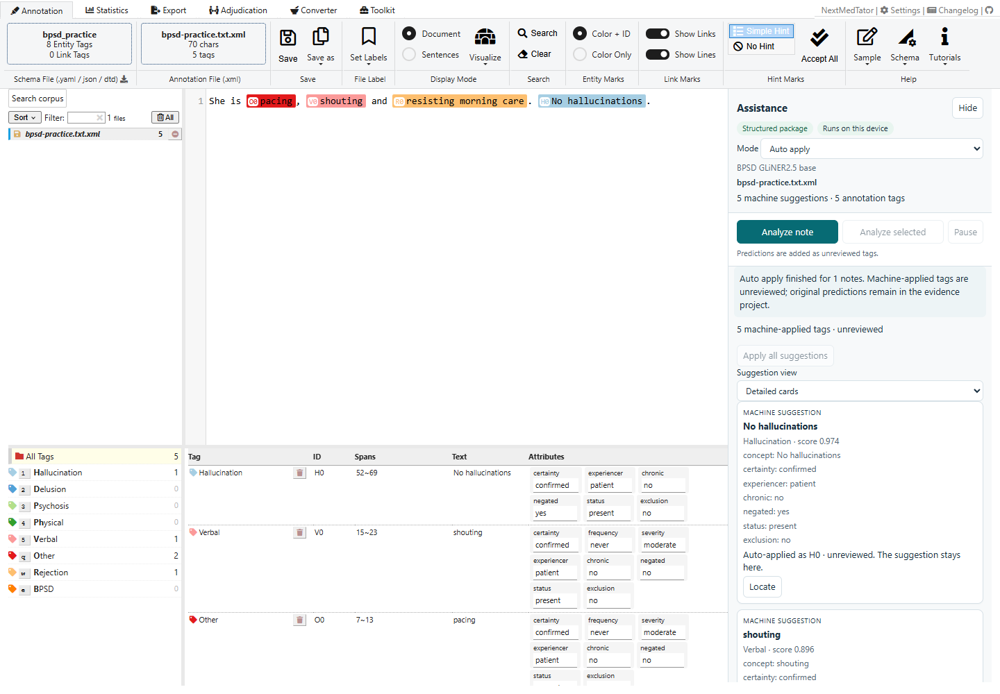

# 2. Local model assistance

**Goal:** generate suggestions for a fictional note using a model on your device.
Start with [the P10 practice task](01-quickstart.md).

## Step 1 — Request a model

Expand **Get a model package** and click **Show approved public model**.
Choose **Download and install clinical-evidence-p10-base-r2** for P10, or
**Download and install bpsd-gliner25-base-r2** for BPSD. Browsing the catalog
loads metadata only; the download button starts the weight transfer.

P10 is about 721 MiB; BPSD is about 725 MiB. Keep at least twice that amount
free for storage and verification, plus runtime memory. Downloads display
received bytes, a progress bar and an estimated remaining time. Initialization
uses a stage indicator because it does not have a reliable ETA.

You can instead choose a local `.nmt-model.zip` under **Local model package**.
The screenshots in this guide use local package import. Imported packages can
be retained with **Install package for offline use**. Public downloads are
installed automatically, and a matching installed package is restored locally
on a later visit. Clearing browser site data removes those stored packages.

## Step 2 — Analyze in Assisted mode

Keep **Mode → Assisted**, then click **Analyze note**. The progress area shows
loading and analysis stages. The note stays on your device.

## Step 3 — Inspect suggestions

The pinned P10 package produces two suggestions for this practice note: fever
and Aspirin. Scroll within Assistance to inspect the evidence and predicted
attributes. **Locate** points to the corresponding text. The annotation table
still has zero tags until you choose to write one.

Expand **Analysis settings** to adjust the suggestion threshold. Lower values
include more spans; higher values are stricter. The change applies to the next
analysis, and old runs retain their original settings. Use **Use default** to
restore the package's threshold. P10 and BPSD use their complete trained
contracts; custom clinical scope filtering is not supported for these codecs.

## Step 4 — Try BPSD or a batch

Export your work before switching tasks. Expand **Try a fictional note** and
choose **BPSD behaviors**, then load the matching BPSD package. With the default
threshold, the included note produces five suggestions in the pinned package.

The screenshot shows **Auto apply**: predictions appear immediately as
**unreviewed** annotation tags. They are not human acceptance decisions.
In **Assisted**, you review and write each suggestion yourself. **Blind**
requires freezing independent annotation before analysis and explicit reveal.
Do not treat already exposed annotations as independent blind labels.

For multiple notes, expand **Batch analysis**, check the desired filenames,
then click **Analyze selected**. Opening a file in the left list does not select
it for a batch. **Pause** stops analysis; completed results are retained.

## If something is unavailable

| Situation | What to do |
|---|---|
| Analyze note is disabled | Load a schema and note; finish loading the matching model package |
| Public download fails on localhost | Import a local package; public R2 CORS allows the deployed app origins |
| Hash or storage verification fails | Check available browser storage and retry the explicit download/import |
| Note exceeds the model limit | Split it deliberately into smaller source documents; the app does not truncate silently |
| No suggestions | Inspect the schema, model identity and threshold; an empty result can be valid |

The public packages use qualified WASM execution. WebGPU is not a selectable
qualified path for these releases. These examples verify the software workflow,
not the clinical accuracy of predictions.

[Previous: first annotation](01-quickstart.md) · [Next: review and export](03-review-export.md)
