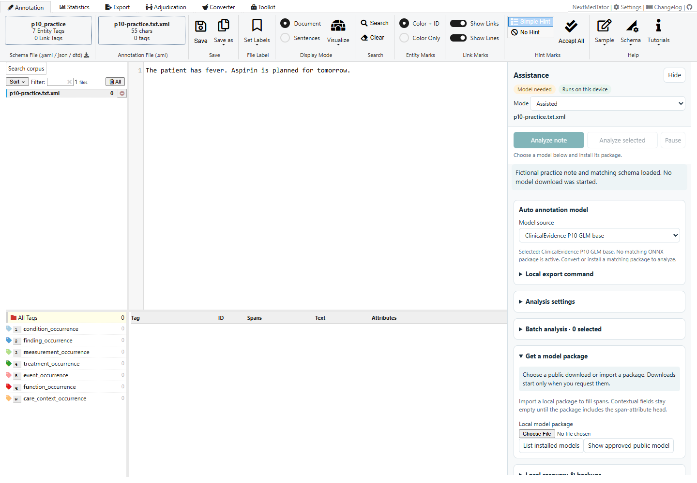
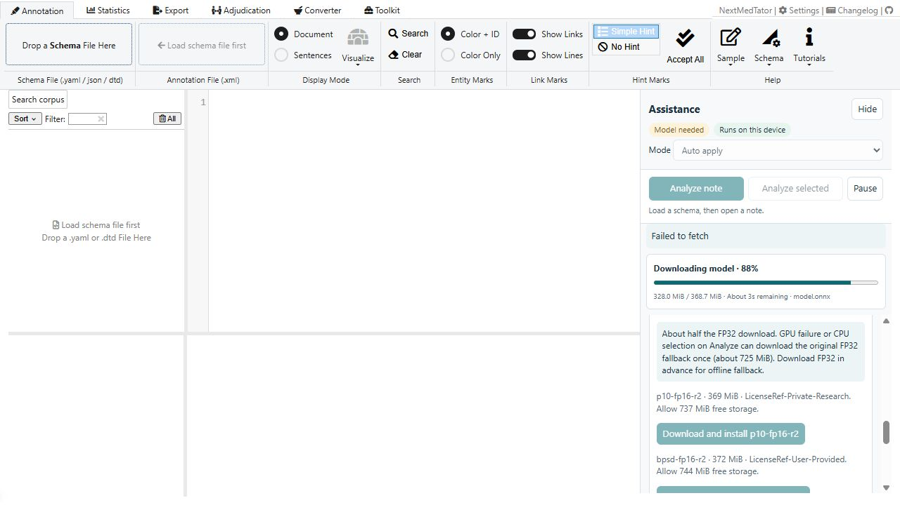
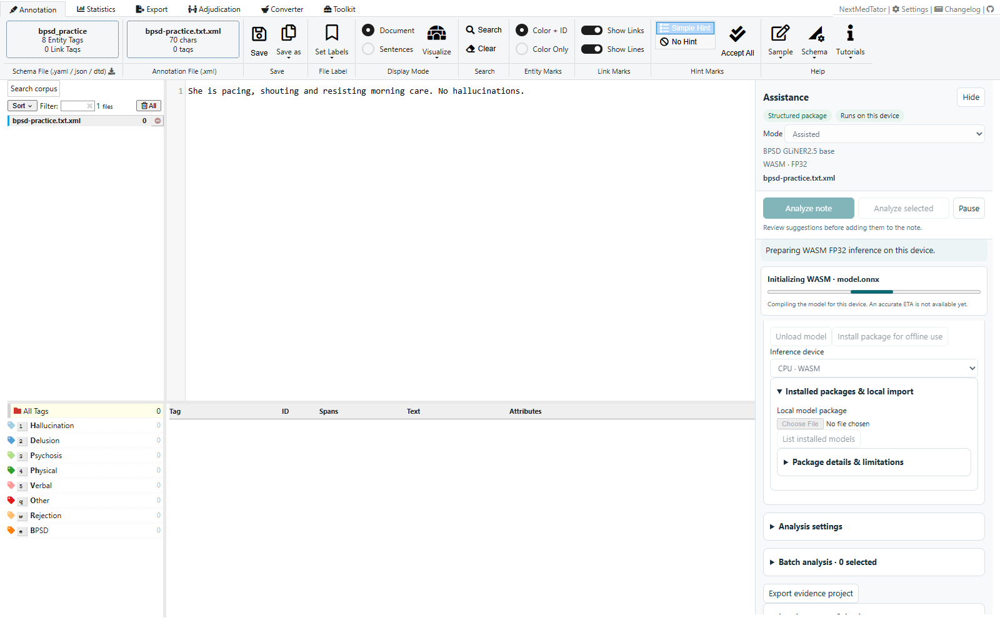
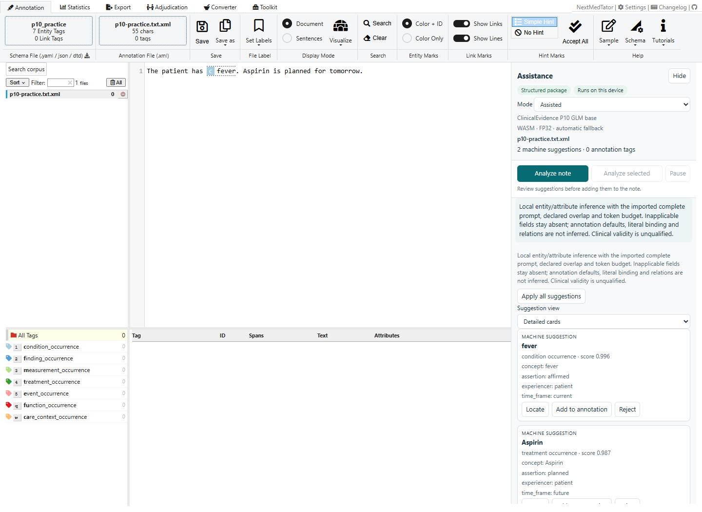
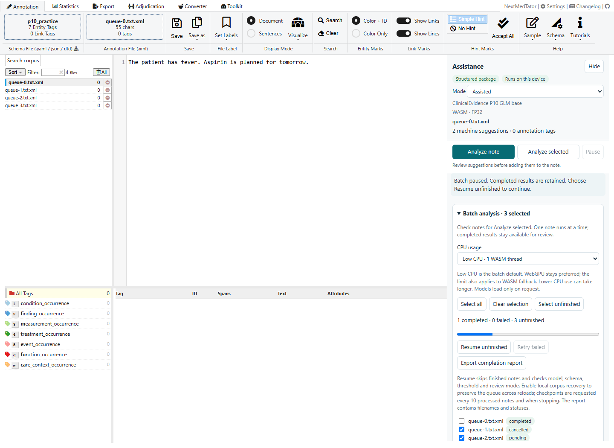
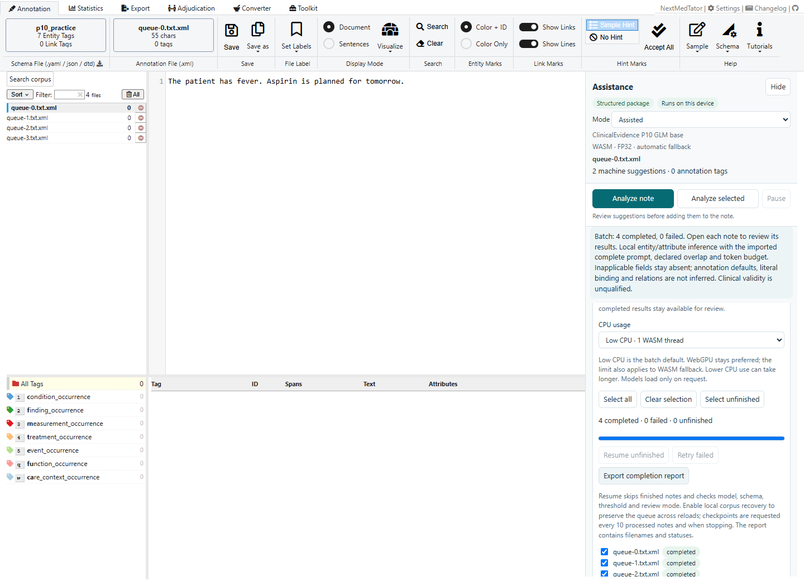
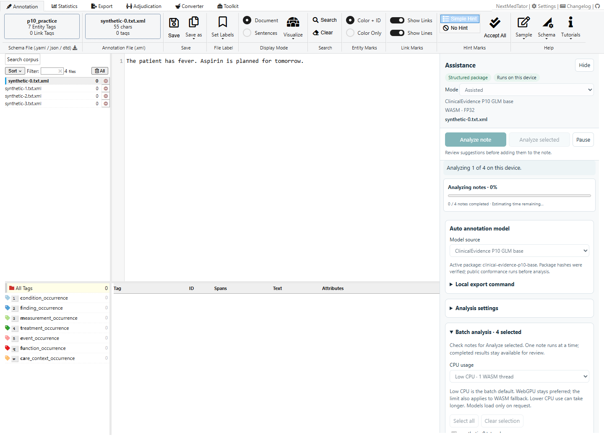

# 2. Local model assistance

**Goal:** generate suggestions for a fictional note using a model on your device.
Start with [the P10 practice task](01-quickstart.md).

The Assistance panel uses the same compact controls as the annotation toolbar.
Labeled icons guide analysis, downloads, installed packages, settings, and
backups. Follow the four numbered steps from top to bottom. Precision, device
and storage controls are collapsed until needed. Section headers expand by click
or keyboard; scroll the panel to reach later steps.

The default device setting is **Automatic · WebGPU with WASM fallback**. Both
models run locally. **Model Options** shows the actual backend after you
analyze. To force CPU execution, choose **Load the model → Model options →
Run on → CPU · WASM**. GPU can be faster, but the measured BPSD examples with many
attributes ran faster on CPU; see [the speed comparison](../docs/nextmedtator/WEBGPU.md).

## Step 1 — Request a model

P10 is first and selected by default in **2. Choose a Model**. In
**3. Load the Model**, click **Download P10** (or **Download BPSD**).
If the recommended package is installed, use **Load Installed** instead.
Firefox and Safari offer **Open Verification Tab**: complete the check there and
return to the app. The download continues automatically. Cancel from either tab.
No download starts until you click the button.

The panel recommends FP16 when the browser exposes compatible WebGPU support, or FP32 otherwise. CPU selection recommends FP32. These hints stay on your device and never trigger a download.

Use **Model Options → Download Format** to choose FP32 (original) or FP16 (smaller
WebGPU package).
Changing this selection starts no download and does not replace the active model.
Unload an active model before choosing another format. Click **Download**, then check **Model Options** for the active package and the actual precision after analysis.

Downloads show bytes and an ETA; verification and installation are separate stages. On **Analyze File**, the panel identifies worker preparation, file checks, tokenizer setup, graph initialization and compatibility checks. **Pause** cancels a download or initialization.

FP16 downloads about 369 MiB for P10 or 372 MiB for BPSD. On an Analyze request,
GPU failure or explicit CPU selection uses the original FP32 WASM model. If it
is not installed, the app downloads and caches it once (about 725 MiB).
Install the matching FP32 package beforehand for offline fallback.
See [measured precision results](../docs/nextmedtator/PRECISION.md).

P10 is about 721 MiB; BPSD is about 725 MiB. Keep at least twice that amount
free for storage and verification, plus runtime memory. Downloads display
received bytes, a progress bar and an estimated remaining time. Initialization
uses a stage indicator because it does not have a reliable ETA.

You can instead choose a local `.nmt-model.zip` under **Import Model Package (.zip)**.
The screenshots in this guide use local package import. Imported packages can
be retained with **Install for Offline Use**. Public downloads are
installed automatically, and a matching installed package offers **Load Installed**
on a later visit. Model weights are never loaded automatically at startup. Clearing browser site data removes those stored packages.

## Step 2 — Analyze in Assisted mode

In **4. Analyze and Review**, change **Review Mode** from the default **Auto Apply** to **Assisted**, then click **Analyze File**. The description under the dropdown summarizes the selected mode. The progress area shows
loading and analysis stages. The note stays on your device.

## Step 3 — Inspect suggestions

The pinned P10 package produces two suggestions for this practice note: fever
and Aspirin. Scroll within Assistance to inspect the evidence and predicted
attributes. **Locate** points to the corresponding text. The annotation table
still has zero tags until you choose to write one.

Expand **More Tools → Analysis Settings** to adjust the suggestion threshold. Lower values
include more spans; higher values are stricter. The change applies to the next
analysis, and old runs retain their original settings. Use **Use Default** to
restore the package's threshold. P10 and BPSD use their complete trained
contracts; custom clinical scope filtering is not supported for these codecs.

## Step 4 — Try BPSD or a batch

Export your work before switching tasks. Expand **More Tools → Try a Sample** and
choose **BPSD Behaviors**, then load the matching BPSD package. With the default
threshold, the included note produces five suggestions in the pinned package.

The screenshot shows **Auto Apply**: predictions appear immediately as
**unreviewed** annotation tags. They are not human acceptance decisions.
In **Assisted**, you review and write each suggestion yourself. **Blind**
requires freezing independent annotation before analysis and explicit reveal.
Do not treat already exposed annotations as independent blind labels.

For multiple notes, expand **Batch Analysis**:

1. Click **Select All**, or check the desired filenames. **Previous** and
   **Next** page through lists longer than 50 notes; selection spans pages.
2. Keep **Automatic** to prefer WebGPU (Metal on supported Apple browsers),
   then fall back to WASM using logical CPU cores minus one, with a minimum of
   one thread. Choose **Low CPU** for one WASM thread or **Balanced** for up to
   four. The CPU limit also applies to fallback; without cross-origin isolation,
   WASM uses one thread. Single-note analysis uses the automatic CPU default.
3. Click **Analyze Selected**. One model session processes notes sequentially.
   The progress bar counts finished notes and estimates remaining time after the
   first note. Different note lengths can change that estimate.
4. Open each note in the left list to review its results. Opening a file does not
   select it for a batch. **Pause** stops inference and retains finished results.
5. Use **Resume** to continue pending or interrupted notes without
   rerunning completed ones. **Retry Failed** processes only failures. Oversized
   notes still need deliberate splitting and a new batch for their changed text.
6. **Select Unfinished** selects notes without a completed result in this queue.
   **Analyze Selected** starts a new batch; **Resume** continues the
   existing one. Use **Export Report** to download a JSON summary with
   filenames, statuses, attempts, model identity and run identifiers.

To resume after a reload, enable **Local recovery & backups → Enable local corpus
recovery** before analysis. Checkpoints are requested every ten processed notes
and on pause/completion. Wait for **Local checkpoint verified** before closing
for an orderly stop; an unexpected crash may require repeating work since the
last checkpoint. Restore the saved corpus, load the same model package, and
choose **Resume**. The app does not download a model or restart
inference automatically. Model, schema, threshold and review mode must match the
original batch. Changing the execution device or CPU limit is allowed.

Unsupported inputs remain failed while the queue continues. A runtime failure
stops that session; retry the failed note or resume the remaining notes. The
completion report contains filenames and status metadata; it does not include
source note text. Blind-mode reports omit suggestion counts.

See the [100-note CPU and RAM benchmark](../docs/nextmedtator/BULK-RESOURCES.md)
for measurements of Low CPU, Balanced and WebGPU, including memory after a job
finishes or is cancelled.

Low CPU can take longer. Models and retained annotation history still need RAM.
No additional
models are downloaded merely by selecting notes or changing CPU usage.

## If something is unavailable

| Situation | What to do |
|---|---|
| Analyze note is disabled | Load a schema and note; finish loading the matching model package |
| Public download fails on localhost | Import a local package; public R2 CORS allows the deployed app origins |
| Hash or storage verification fails | Check available browser storage and retry the explicit download/import |
| Note exceeds a single-window limit | Enable **Split Long Files into Windows**; see [long-note limits](04-large-collections.md). A token that cannot fit with the full prompt is rejected, never silently truncated |
| No suggestions | Inspect the schema, model identity and threshold; an empty result can be valid |

The public FP32 and FP16 packages support qualified WebGPU execution with
original FP32 WASM fallback. These examples verify the software workflow,
not the clinical accuracy of predictions.

[Previous: first annotation](01-quickstart.md) · [Next: review and export](03-review-export.md)

Public verification needs a current Chrome/Edge browser with credentialless iframe support. **Installed Models** works without CAPTCHA. See [download protection](../docs/nextmedtator/DOWNLOAD-PROTECTION.md).
