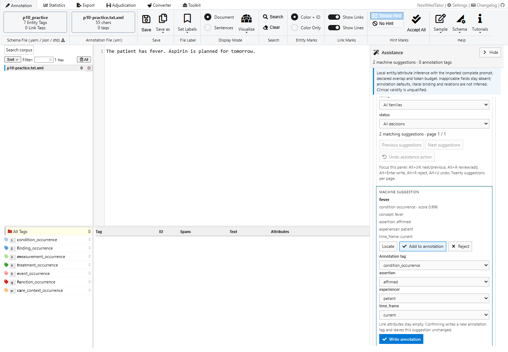
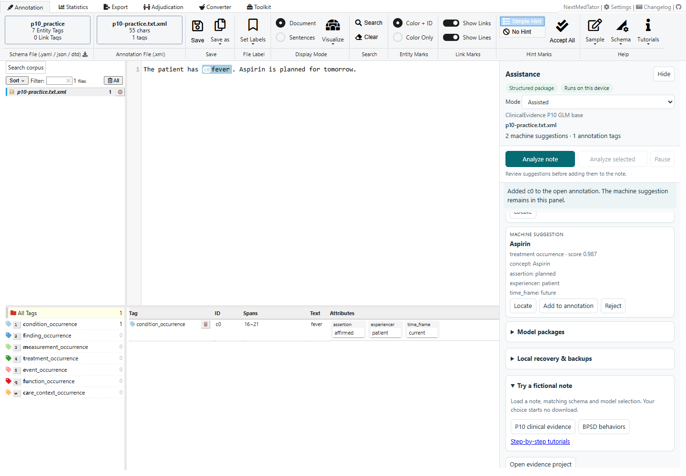
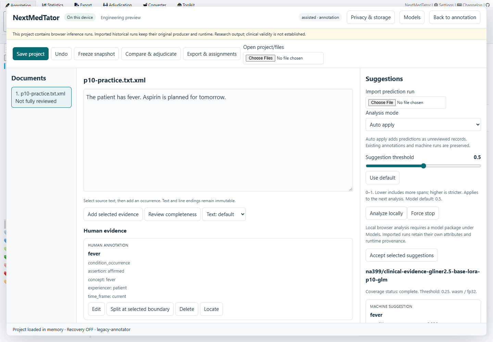
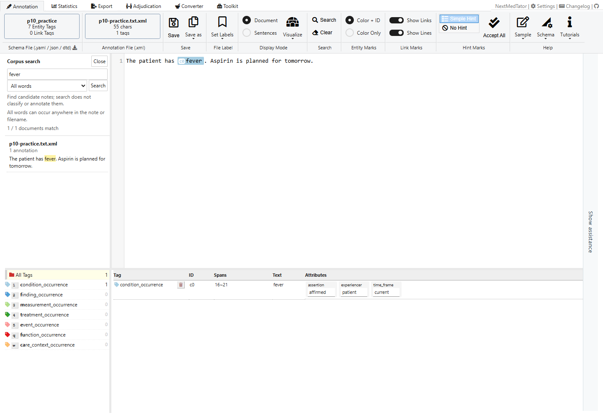
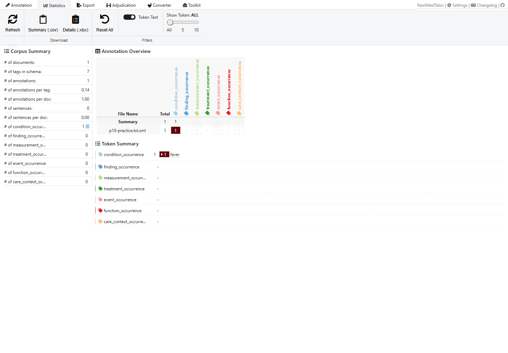
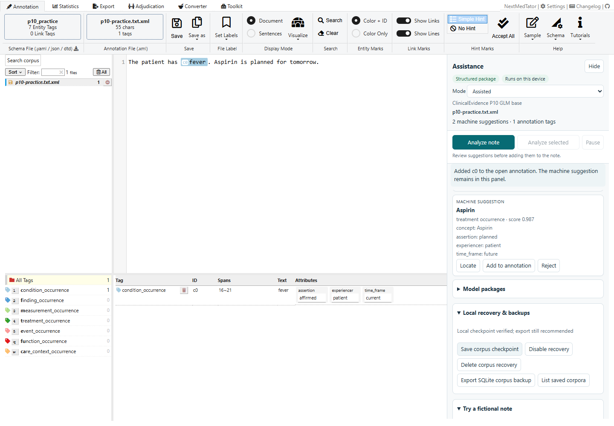

# 3. Review, export and recover

**Goal:** turn a suggestion into a reviewed annotation, then save and reopen it.
Start after [P10 analysis in Assisted mode](02-local-models.md).

## Step 1 — Review the fields

On the **fever** suggestion, click **Accept**. Check the entity tag
and attributes. Correct any fields that need human judgment, then click
**Add Tag**. Choosing **Reject** instead records a rejection without
adding a tag to the note.

## Step 2 — Verify the annotation

The annotation table now contains the reviewed fever span. The suggestion
remains in Assistance with its decision recorded. This keeps the model output
separate from your annotation edits. In this example, Aspirin is still pending;
accepting one suggestion does not complete review of the note.

## Step 3 — Export and reopen

Click **Export Evidence Project** in Assistance to download a `.nmt.zip`.
Then click **Open Evidence Project**, choose the downloaded file under
**Open project/files**, and verify the source text, human evidence and machine
run. Use **Save project** after making changes in this workspace.

Use **Back to annotation** to return to the main screen. The ribbon's
**Save as → Download a copy** exports XML for interchange. The **Export** tab
provides additional corpus formats. Keep the native `.nmt.zip` when you need
run provenance, review decisions and snapshots; interchange formats may not
represent all of that history.

## Step 4 — Search and inspect the corpus

Click **Search corpus**, enter `fever`, and run the search. Click a result to
open its note. Search runs locally and supports words, phrases, prefixes and
advanced expressions. Close the search panel to return to the file list.

Open **Statistics** in the top ribbon to inspect the corpus annotation counts.
Use **Refresh** there after changing annotations if the displayed summary is
out of date. Return with **Annotation**.

## Step 5 — Enable recovery when you want it

Expand **Recovery & Backup**, click **Enable Recovery**,
and confirm storing the corpus in this browser profile. Wait for the verified
checkpoint status. Subsequent annotation edits are checkpointed locally.

On a later visit, expand this section, choose **List Recovery Copies**, and click
the intended **Restore corpus** entry. Restoring replaces current in-memory
notes after confirmation. **Disable Recovery** stops checkpointing; **Delete
corpus recovery** removes the stored copy. Loading a practice task disables
recovery for the previous corpus and preserves its already saved copy.

Browser recovery is tied to this origin and browser profile. It can disappear
when site data is cleared. Keep exported files as your portable backup. Model
installation and corpus recovery are separate choices.

[Previous: local models](02-local-models.md) · [Tutorial index](README.md)
