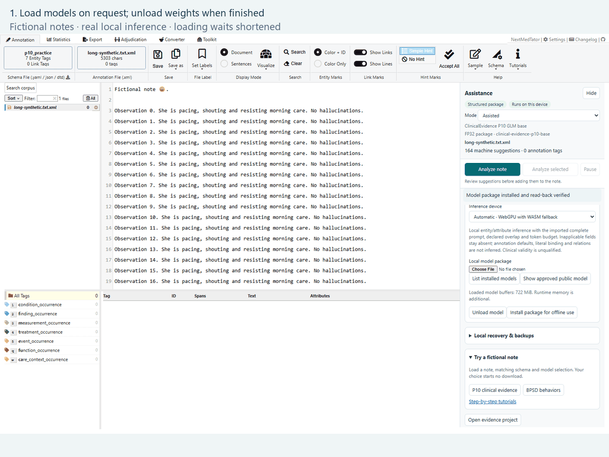
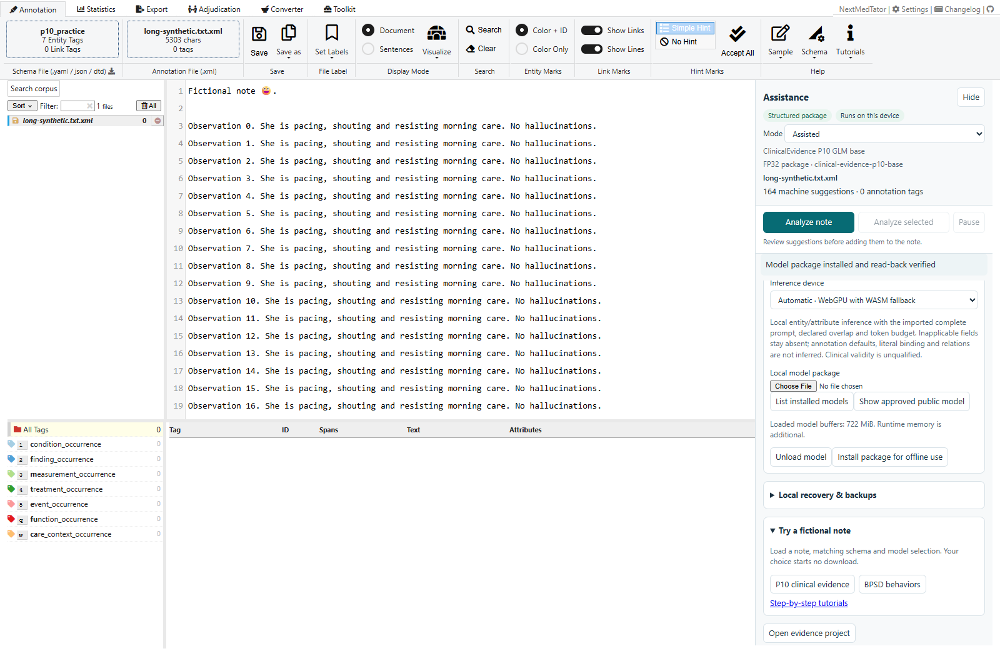
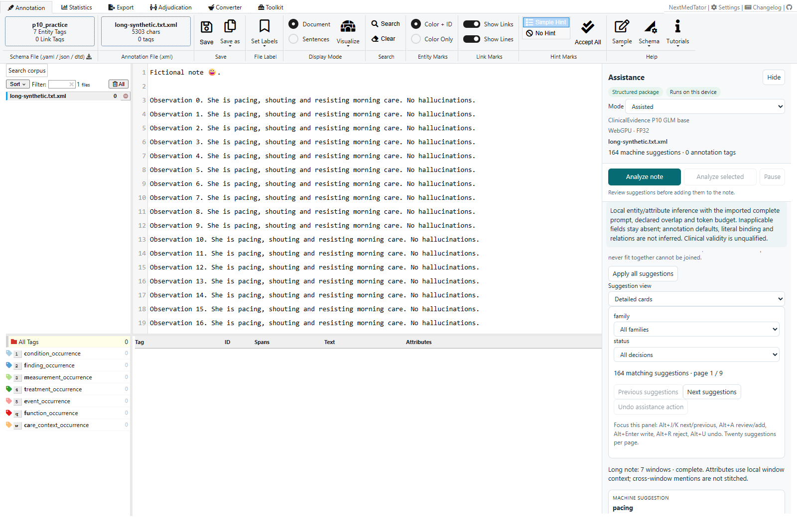
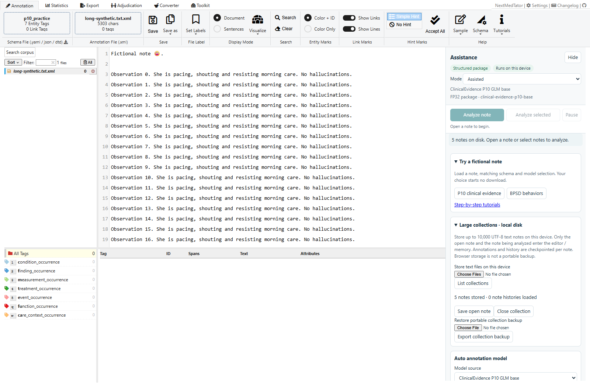
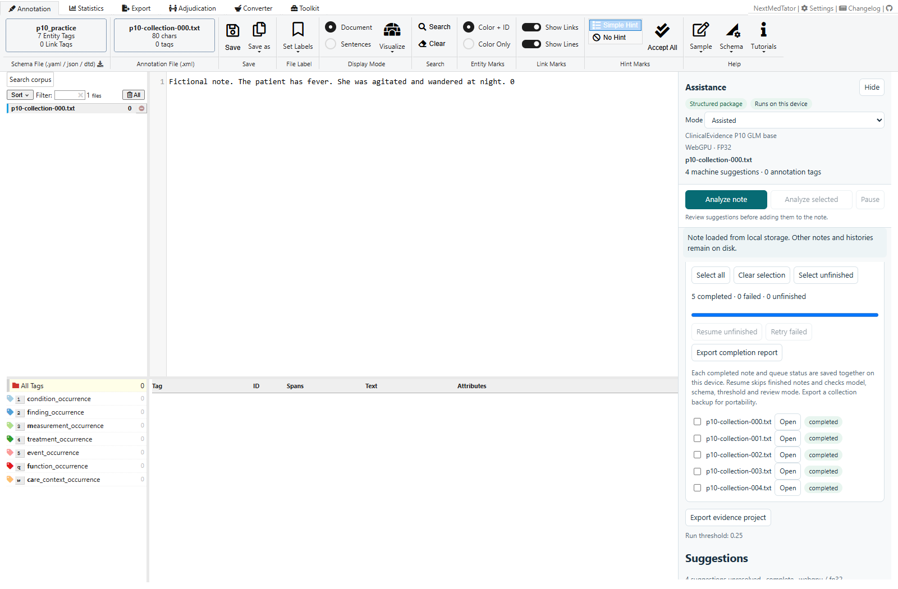

# Long notes, model memory and large collections

This guide uses fictional notes. All inference and collection storage stay on
your device. Model downloads still start only after an explicit request.

## 1. Load and unload a model

1. Open **Model packages** and choose **List installed models**. This reads the
   package inventory without loading model weights.
2. Click **Use installed …**, import a model package, or explicitly download one.
3. The panel shows model-buffer size separately from the browser storage estimate.
   Model-buffer bytes are not a measurement of total browser RAM or GPU memory.
4. Click **Unload model** when finished. The inference worker and model references
   are released; cached files, notes and annotation history remain available.
   Browser garbage collection determines when process memory falls.
5. **Remove installed …** deletes that cached package after confirmation. It can
   be imported or downloaded again.

## 2. Analyze a long note

1. Load P10 or BPSD and a matching schema, then open a note.
2. Under **Analysis settings**, leave **Analyze long notes with GLiNER2.5 windows**
   checked. Short notes continue through the original single-window path.
3. Click **Analyze note**. Long inputs are processed sequentially through
   overlapping windows, normally up to 384 model-split words with up to 64 words
   of overlap. Windows shrink to fit the complete prompt and encoded-token limit,
   and prefer nearby sentence or section boundaries.
4. Watch the window progress and review the completed run's coverage/window count.
   Locations always refer to the original note, including Unicode characters.
5. Review suggestions as usual. Overlap duplicates keep the higher-scoring span
   together with its attributes. P10's flat and BPSD's allow-overlap policies stay
   distinct. Attributes use window-local context; mentions that never fit wholly
   inside a window and cross-window relations cannot be joined.

This follows the [GLiNER2.5 long-context approach](https://github.com/fastino-ai/GLiNER2/blob/main/tutorial/12-long_context.md),
with additional encoded-budget checks for these exported packages. It is not a
claim of clinical accuracy or whole-document reasoning. Turning the option off
restores oversized-input rejection. An individual token too large for any window
is rejected explicitly.

## 3. Review without losing your place

1. Filter suggestions by **family** and **status**. At most 20 suggestions render
   per page; use **Previous suggestions** and **Next suggestions** for more.
2. Focus a suggestion or the review-controls box. Use **Alt+J / Alt+K** to move
   through the current page and locate the source span.
3. **Alt+A** opens the annotation form. Changed attributes are highlighted.
   **Alt+Enter** writes the reviewed annotation; **Alt+R** rejects the suggestion.
4. Click **Undo assistance action** or press **Alt+U** to undo the last individual
   review or **Apply all suggestions** action. Original model predictions remain.
5. Undo refuses to remove tags that were subsequently edited or referenced by
   other annotations. Resolve those edits/links explicitly. The panel retains up
   to 20 undo entries in the current session; they are not portable undo history.

## 4. Store a large collection locally

1. Load the schema first. Expand **Large collections · local disk**.
2. Under **Store text files on this device**, select UTF-8 `.txt` files. This is
   an explicit storage action; it supports up to 10,000 notes and 16 MiB per note.
   Ordinary XML import remains available through the original workspace.
3. The collection index stays in memory. Under **Batch analysis**, click **Open**
   beside a filename to load that note into the original annotation editor.
   Other notes and their histories stay on disk.
4. Use **Select all**, individual checkboxes, or **Select unfinished**, then
   **Analyze selected**. One model session processes notes in sequence. The open
   note and current inference note are the only note histories retained in RAM.
5. **Pause** stops the worker. Each completed note and its queue status are saved
   atomically. After reloading, choose **List collections → Open collection …**,
   explicitly load the model, and **Resume unfinished**. Completed notes are skipped.
6. **Retry failed** targets failed notes. Changes to model, schema, threshold or
   review mode require restoring the queued settings or starting a new batch.
7. Opening another note saves the current one. Edits are also saved locally after
   a short idle delay. **Save open note** requests an immediate checkpoint.
   Disk-backed collections do not need the ordinary whole-corpus recovery toggle.

For independent blind annotation, open and freeze each note and analyze it
individually. Disk-backed bulk jobs support Assisted and Auto apply modes.
Close the collection before importing an ordinary workspace. Model inference
still defaults to WebGPU, falling back to CPU cores minus one; Low CPU and
Balanced remain selectable.

## 5. Export and restore a portable collection

1. Click **Export collection backup** and choose a `.jsonl` destination in desktop
   Chrome or Edge. Notes and histories are written one at a time rather than
   assembled into a large in-memory archive.
2. Keep the resulting file separately from browser storage. Clearing site data
   also removes local collections.
3. To restore, use **Restore portable collection backup** and select the file.
   Per-note integrity checks and the final record count/hash chain reject
   truncated or corrupted backups; a failed import removes its partial copy.
4. Single-note XML and evidence-project export remain available in the editor.
   **Export completion report** contains queue metadata rather than a full backup.

Only one tab should edit a collection. A revision check rejects stale concurrent
saves instead of silently overwriting another tab's work. The collection remains
local; collaborative server editing is not part of this workflow.

Collection screenshots use a five-note fictional example from the real browser regression.
The same queue also passed with 100 notes per model; storage/backup checks used
10,000 notes. See the [validation receipt](../docs/nextmedtator/WORKFLOW-IMPROVEMENTS.md).
